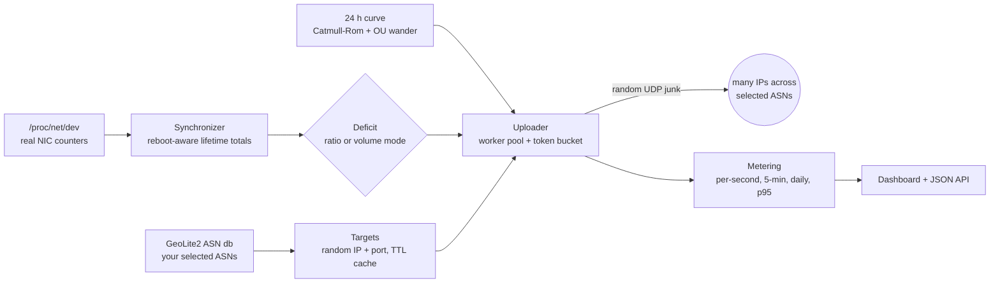

<div align="center">

# Tavazon · تـوازن

**Keep an asymmetric hosting quota in balance by sending shaped, distributed junk traffic.**

[](https://github.com/salehi/tavazon/releases/latest)
[](https://github.com/salehi/tavazon/actions/workflows/release.yml)
[](https://github.com/salehi/tavazon/releases)
[](go.mod)
[](LICENSE)
<br>
[](#install)
[](#build-from-source)
[-success)](docs/RED_LINES.md#x1--curated-vendored-dependencies)
[](#the-dashboard)

</div>

---

Tavazon (Persian for *balance*) is a single static Go binary. It reads your server's
real network counters, works out how much **upload** you are short of the ratio your
provider expects, and makes up the difference with random UDP datagrams. The
datagrams are spread across thousands of IPs in AS numbers you choose, and their
volume follows a smooth day-and-night curve so the traffic looks organic. It needs
no database, no Redis, and no monitoring stack. The dashboard is built into the
binary.

## Table of contents

- [Why this project exists](#why-this-project-exists)
- [How it works](#how-it-works)
- [Features](#features)
- [Ethical boundary](#ethical-boundary)
- [Install](#install)
  - [One-line installer (Linux + systemd)](#one-line-installer-linux--systemd)
  - [Docker](#docker)
  - [Release archives](#release-archives)
  - [Build from source](#build-from-source)
- [Obtaining the GeoLite2 databases](#obtaining-the-geolite2-databases)
- [Configuration](#configuration)
- [The dashboard](#the-dashboard)
- [Managing the service](#managing-the-service)
- [CLI reference](#cli-reference)
- [Project layout & docs](#project-layout--docs)
- [Contributing](#contributing)
- [License](#license)

---

## Why this project exists

Many Iranian hosting and transit providers sell servers with an **asymmetric traffic
quota**. A typical plan is 1:8: for every 1 GB the server *downloads*, it is expected
to *upload* about 8 GB. If downloads grow past that share, the server is throttled or
suspended.

That is a problem for the people who most need those servers: operators of proxies
and VPNs that help users get around national censorship. A proxy's traffic is
roughly symmetric, so it uses up its download allowance long before its upload
allowance and gets cut off.

The workaround is to **make extra upload**: send junk datagrams that are dropped at
the destination. Nothing useful is transferred, but the NIC egress counter, which is
what the provider bills on, goes up, and that frees room for real downloads.

Tavazon is a ground-up Go rewrite of [namizun](https://github.com/salehi/namizun),
which pioneered this idea in Python. namizun's ideas were sound, but its
implementation was fragile and easy to fingerprint:

| namizun | Tavazon |
|---|---|
| Python + a required **Redis** server | One static binary; state in local files |
| All-zero payloads in fixed size buckets, which DPI can spot | Random bytes, sizes, ports and gaps in every datagram |
| Hourly **step** curve with visible jumps on the hour | Continuous **Catmull-Rom** curve plus slow random wander |
| Static, hand-maintained IP-range list | Live **ASN-based** targeting from MaxMind GeoLite2 |
| One OS thread per target IP | Bounded goroutine pool and a shared token bucket |
| No exception handling; recursion used for control flow | Panic recovery in every goroutine; no recursion |
| Interactive TUI only, no headless config | JSON config, env vars, flags, and a web dashboard |
| No history | Per-second, 5-minute and daily metering, plus the **95th-percentile** bill |

The full list of 18 flaws and the reasoning behind every design choice is in
[docs/project.md](docs/project.md).

## How it works



Each engine cycle runs at a random interval of 5 to 30 seconds, so there is no fixed
tick:

1. **Measure.** It reads RX/TX bytes from `/proc/net/dev`, excluding loopback. A
   *synchronizer* offset keeps lifetime totals continuous across reboots, which reset
   the kernel counters.
2. **Compute the deficit.** In **ratio mode** (the default), the target is
   `upload = download × multiplier`. For example, with 100 GB downloaded, 300 GB
   uploaded and a multiplier of 8, the deficit is 500 GB. In **volume mode**, the
   target is a fixed budget such as `2 GiB every 24h`, spread along the curve.
3. **Shape it.** A periodic, smooth curve over Tehran local time sets the intensity:
   busy in the evening, near zero around 4 to 5 AM. A mean-reverting random walk
   makes each day slightly different. Worker count and send rate follow the
   intensity, and a slew limit stops them from jumping between cycles.
4. **Send.** A bounded pool of workers sends datagrams to random hosts and ports
   inside the prefixes of your selected ASNs. A shared token bucket caps total
   egress. Each cycle sends only a fraction of the deficit, so the gap closes
   gradually.
5. **Record.** Every byte is metered per ASN. The dashboard shows a 24-hour
   per-second chart, a 5-minute history (used for the **95th-percentile** billing
   figure), and daily totals kept indefinitely.

## Features

- **Two target modes:** keep a ratio, or push a fixed volume over a time window.
  You can switch between them live from the dashboard.
- **Organic traffic shape:** a continuous 24-hour curve with editable anchor
  points. It has no steps at hour boundaries and no repeating pattern.
- **Nothing for DPI to match:** datagram size, content, destination port and the
  gap between packets are all uniformly random. Datagrams never exceed 1472 bytes,
  so they are never fragmented.
- **ASN targeting:** you pick the AS numbers to send to. The picker lists Iranian
  ASNs first, and the IP set churns through a TTL cache, so destinations never
  settle on a fixed set.
- **Billing visibility:** the dashboard shows the 95th-percentile rate and total
  volume for the current billing window, which are the two figures providers
  charge on.
- **Embedded dashboard:** live stats, the curve editor, CPU, RAM and bandwidth
  gauges, a per-ASN breakdown, history charts, an audit log of setting changes,
  and a log tail. All of it is served from the binary with no CDN, so it works on
  a filtered network.
- **Live config:** changes made in the dashboard, including ASN and curve edits,
  apply on the next cycle with no restart. They are written to `config.json` and
  recorded in an audit log.
- **Robust:** a panic in any goroutine is recovered and logged. State is written
  atomically. Start/Stop state survives a crash or reboot.
- **Small footprint:** CGO is disabled, the one dependency (`maxminddb-golang`) is
  vendored, and builds work fully offline. An optional Prometheus `/metrics`
  endpoint is available.

## Ethical boundary

Tavazon sends traffic **to and from infrastructure you operate, against a quota you
are legitimately subject to**. It is not a stress-testing or flooding tool. Its
design keeps the load on any one destination tiny:

- Traffic is spread across many prefixes and hosts, and each IP receives only a
  trickle.
- The token-bucket rate limit and the `max_workers` cap are always on. There is no
  "turbo" mode.
- Payloads are inert random bytes. They never contain protocol headers or anything
  designed to trigger a response.

These limits are hard constraints, documented in
[docs/RED_LINES.md](docs/RED_LINES.md). **Read them before deploying.**

## Install

| Method | Best for | Runtime |
|---|---|---|
| [One-line installer](#one-line-installer-linux--systemd) | Production Linux servers | systemd service in `/opt/tavazon` |
| [Docker](#docker) | Container hosts, quick trials | `scratch` image, host networking |
| [Release archives](#release-archives) | Manual or air-gapped installs | Any supported OS/arch |
| [Build from source](#build-from-source) | Development | Docker only; Go is not needed on the host |

> **In every case** you also need the two free GeoLite2 `.mmdb` files. See
> [Obtaining the GeoLite2 databases](#obtaining-the-geolite2-databases).

### One-line installer (Linux + systemd)

```sh
curl -fsSL https://raw.githubusercontent.com/salehi/tavazon/main/install.sh | sh
```

The installer downloads the release binary for your CPU (x86_64, arm64 or armv7),
creates a self-contained directory, installs the hardened systemd unit, and enables
and starts the service:

```
/opt/tavazon/
├── tavazon              # the binary
├── config.json          # copied from config.example.json (an existing one is kept)
├── maxmind_files/       # put the GeoLite2 .mmdb files here
└── data/                # runtime state, metering, logs
```

The service is system-wide, so the script needs root and calls `sudo` when it has
to. If the `.mmdb` files are missing, it prints a warning. The service still starts,
but the uploader stays idle until the files are in place.

Overrides:

```sh
curl -fsSL .../install.sh | TAVAZON_DIR=/srv/tavazon sh    # install dir (default /opt/tavazon)
curl -fsSL .../install.sh | sh -s -- 1.3.2                 # pin a version instead of the latest
```

### Docker

The [Dockerfile](Dockerfile) is a two-stage build. The binary is compiled offline
in `golang:1.22` from the vendored sources, then copied into an empty `scratch`
image. Tavazon is static and does no DNS or TLS, so the image needs nothing else.

| Image | Base | Contents | Exposes |
|---|---|---|---|
| `salehi/tavazon:latest` | `scratch` | `/tavazon` binary, default `/config.json` | `8081` (dashboard), volume `/data` |

> **No prebuilt image is published to a registry yet.** You build it locally with
> one command, shown below. The tag above is the local name used by the
> [Makefile](Makefile) and [docker-compose.yml](docker-compose.yml).

**With Docker Compose (recommended):**

```sh
git clone https://github.com/salehi/tavazon.git && cd tavazon
cp config.example.json config.json         # create this before the first run, or Docker makes a directory
# copy GeoLite2-ASN.mmdb and GeoLite2-Country.mmdb into ./maxmind_files/
docker compose up -d --build               # or: make up
docker compose logs -f                     # or: make logs
```

**With plain Docker:**

```sh
make image VERSION=1.3.2                   # builds and tags salehi/tavazon:latest

docker run -d --name tavazon --restart always --network host \
  -v "$PWD/config.json:/config.json" \
  -v "$PWD/data:/data" \
  -v "$PWD/maxmind_files:/maxmind_files:ro" \
  salehi/tavazon:latest
```

Things to know:

- **`--network host` is required.** Tavazon must read the *host's* real NIC counters
  and send from the host's real IP. On a bridged network it would only see the
  container's own interface.
- `config.json` is mounted read-write because the dashboard saves changes to it.
- Environment variables override `config.json` on every start. The sample compose
  file sets `TAVAZON_TARGET_RATIO_MULTIPLIER=8`. Remove that line if you want a
  multiplier set in the dashboard to survive a restart.

### Release archives

Every `release-*` tag is built by
[GitHub Actions](.github/workflows/release.yml) and published on the
[Releases](https://github.com/salehi/tavazon/releases) page with a `SHA256SUMS.txt`:

| OS | x86_64 | arm64 | armv7 |
|---|:---:|:---:|:---:|
| Linux | ✅ | ✅ | ✅ |
| macOS | ✅ | ✅ | not available |
| Windows | ✅ | ✅ | ✅ |

Each archive contains the binary, `config.example.json`, `tavazon.service`, this
README and the LICENSE. Only **Linux** can generate traffic, because Tavazon reads
`/proc/net/dev`. The macOS and Windows builds compile and run the dashboard, which
is useful for development.

### Build from source

The host needs only Docker. The [Makefile](Makefile) runs every Go command inside
`golang:1.22` as your own user:

```sh
make build        # -> bin/tavazon  (static, CGO-free, built offline with -mod=vendor)
make test         # run the test suite
make check        # fmt + vet + test
make image        # build the Docker image
make help         # list all targets
```

If you already have Go 1.22+ installed, `make build GO=go` uses it instead of the
container.

## Obtaining the GeoLite2 databases

Tavazon resolves destination IPs from MaxMind's free GeoLite2 databases. They are
**not included**: MaxMind's licence forbids redistributing them, and `.gitignore`
excludes every `*.mmdb`.

1. Create a free account at <https://www.maxmind.com/en/geolite2/signup>.
2. Download **GeoLite2 ASN** and **GeoLite2 Country** in `.mmdb` format.
3. Put both files in `maxmind_files/`:

   ```
   maxmind_files/GeoLite2-ASN.mmdb
   maxmind_files/GeoLite2-Country.mmdb
   ```

Without them Tavazon still starts and the dashboard shows the problem, but the
uploader stays idle.

## Configuration

Everything lives in `config.json`. Start from
[config.example.json](config.example.json); the full annotated schema is in
[docs/project.md §8](docs/project.md#8-configuration-schema).

Settings are applied in this order, lowest to highest:
**built-in defaults → `config.json` → `TAVAZON_*` environment variables → CLI
flags.** Every scalar setting has an environment variable named
`TAVAZON_<SECTION>_<FIELD>`, for example `TAVAZON_WEB_LISTEN=0.0.0.0:8081`.

The settings you are most likely to change:

| Key | Default | Meaning |
|---|---|---|
| `target.mode` | `ratio` | `ratio` keeps upload at download × multiplier; `volume` sends a fixed budget per window |
| `target.ratio.multiplier` | `8` | The ratio your provider expects (8 for a 1:8 plan) |
| `target.volume.bytes` / `.window` | `1 GiB` / `24h` | Budget for volume mode |
| `geoip.selected_asns` | `[]` | AS numbers to send to. **The uploader stays idle while this is empty** |
| `network.interface` | `""` | `""` sums all non-loopback interfaces that are up; or name one, e.g. `eth0` |
| `uploader.speed_coefficient` | `1` | 1 to 5; multiplies `base_rate_bps` (default 512 KiB/s at intensity 1) |
| `uploader.max_workers` | `300` | Hard cap on concurrent workers |
| `curve.anchors` | day shape | 24 hourly intensities (0 = idle, about 2 = peak); the curve passes smoothly through them |
| `web.listen` | `127.0.0.1:8081` | Dashboard bind address |
| `web.auth_token` | `""` | **Required** if `web.listen` is not local |

The dashboard has an **Auto-tune** button that fills in the uploader settings
from your target. In volume mode it uses the budget and window; in ratio mode it
uses the link capacity. You review the values and press Apply.

## The dashboard

The dashboard is a single self-contained page served at `http://127.0.0.1:8081`:

- Header toggles for **Start/Stop** and **Dev mode**. Dev mode sends all traffic to
  one local IP so you can test the pipeline without a VPS.
- Stat cards: total upload and download, current ratio, speeds, workers, deficit,
  and curve intensity.
- A 24-hour per-second traffic chart and an interactive **curve editor**.
- CPU, RAM and bandwidth gauges.
- **Billing:** 95th-percentile rate and total volume for the current window.
- Per-ASN breakdown and history charts covering days to months.
- The settings form, with an explanation of the math under each field, a live ASN
  picker, and Auto-tune.
- An audit log of setting changes, counter tools, and a live log tail.

> ⚠️ **Security:** the dashboard can rewrite the config and reset counters. It binds
> to `127.0.0.1` by default. If you set `web.listen` to a non-local address you
> **must** set `web.auth_token`, sent as `Authorization: Bearer <token>` or
> `?token=`. Tavazon logs a loud warning if it is missing. Put a TLS-terminating
> reverse proxy in front of any remote access, or reach the dashboard through an
> SSH tunnel:
> `ssh -L 8081:127.0.0.1:8081 your-server`.

There is also a JSON API (`/api/stats`, `/api/config`, `/api/billing`,
`/api/history`, …), an optional Prometheus endpoint at `/metrics`, and a liveness
probe at `/healthz`. See [docs/project.md §10](docs/project.md#10-web-dashboard--http-api).

## Managing the service

```sh
sudo systemctl status tavazon      # health
sudo journalctl -u tavazon -f      # live logs
sudo systemctl restart tavazon     # pick up edits made directly to /opt/tavazon/config.json
```

Changes made in the dashboard take effect on the next cycle, with no restart.

The unit file, [systemd/tavazon.service](systemd/tavazon.service), runs with
`NoNewPrivileges`, `ProtectSystem=strict` and `ProtectHome`, makes only
`/opt/tavazon/data` writable, and restarts on failure. To install it by hand, copy
it to `/etc/systemd/system/` and run `sudo systemctl enable --now tavazon`.

## CLI reference

```
tavazon [flags]
  -config string      path to config.json (default "config.json")
  -state string       override state file path
  -asn-db string      override GeoLite2-ASN.mmdb path
  -country-db string  override GeoLite2-Country.mmdb path
  -listen string      override web listen address
  -mode string        override target mode: ratio|volume
  -multiplier int     override ratio multiplier
  -stopped            start in the stopped state
  -no-web             disable the web dashboard
  -log-level string   debug|info|warn|error
  -print-config       print the effective merged config and exit
  -version            print version and exit
```

## Project layout & docs

```
cmd/tavazon/          entrypoint: flags, wiring, signal handling
internal/
  config/             Config struct, load/validate, env + flag overlays
  netstat/            /proc/net/dev parser
  geoip/              MaxMind ASN + Country reader, ASN → prefix index
  schedule/           ratio/volume deficit math, continuous 24 h curve
  targets/            ASN-weighted random IP + port selection
  uploader/           worker pool, token bucket, random payloads
  metering/           time-series store, 95th percentile, audit log
  engine/             the orchestration loop
  web/                HTTP API + embedded dashboard (static/index.html)
  metrics/ sysstat/ state/ logging/
systemd/              hardened service unit
```

| Document | What's in it |
|---|---|
| [docs/project.md](docs/project.md) | The design document and source of truth: every algorithm, package, and config field |
| [docs/RED_LINES.md](docs/RED_LINES.md) | Hard ethical and engineering limits that no change may cross |
| [docs/STANDARDS.md](docs/STANDARDS.md) | Engineering standards and the review checklist |
| [docs/ROADMAP.md](docs/ROADMAP.md) | The phased build plan |
| [docs/CONTRIBUTING.md](docs/CONTRIBUTING.md) | Day-to-day workflow, quality gates, PR expectations |

## Contributing

Read [RED_LINES.md](docs/RED_LINES.md) and [CONTRIBUTING.md](docs/CONTRIBUTING.md)
first. In short: keep to the dependency allowlist (one module, vendored), recover
panics in every goroutine, never commit a `.mmdb` file, and run `make check` before
you push. A bug fix should come with a regression test.

## License

[MIT](LICENSE) © 2026 Salehi
